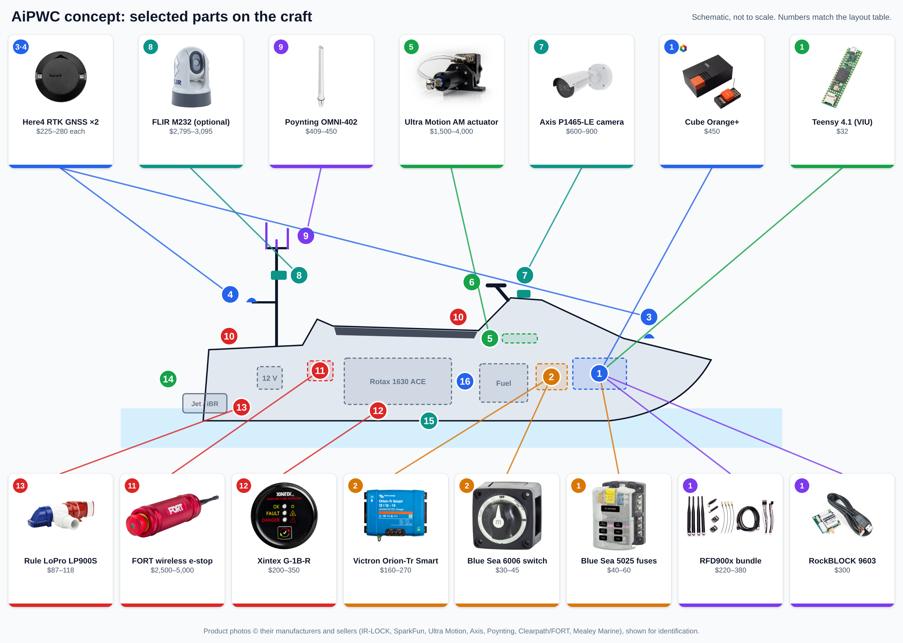
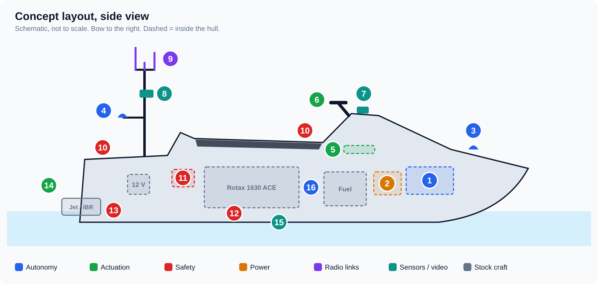
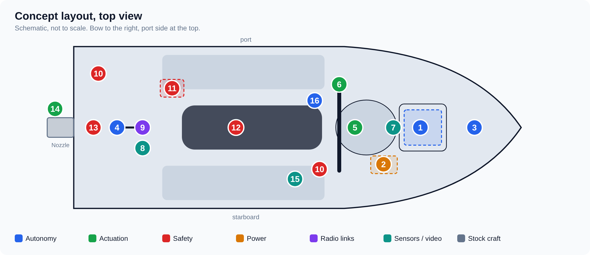
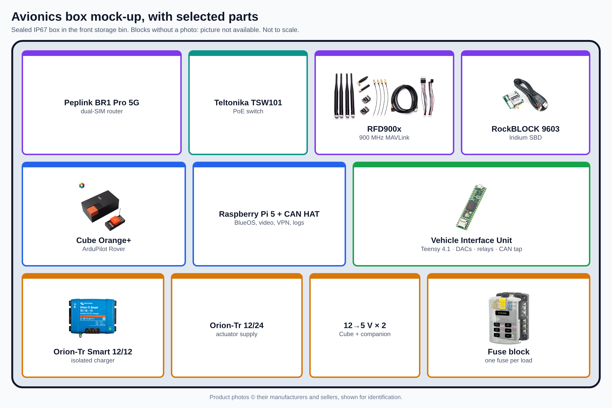
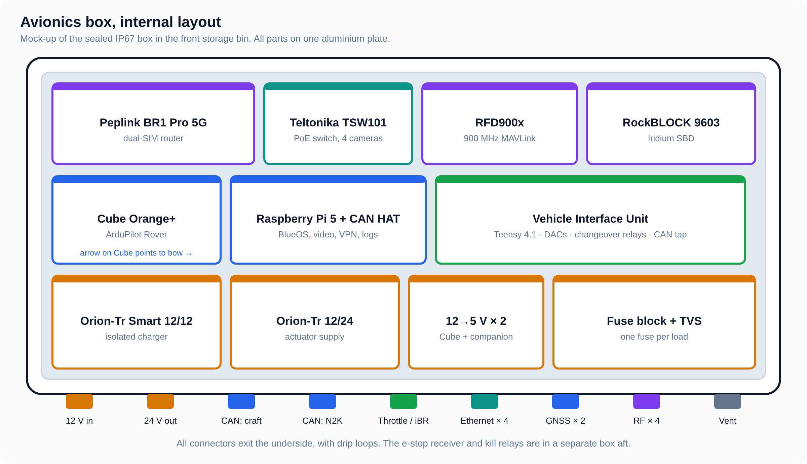
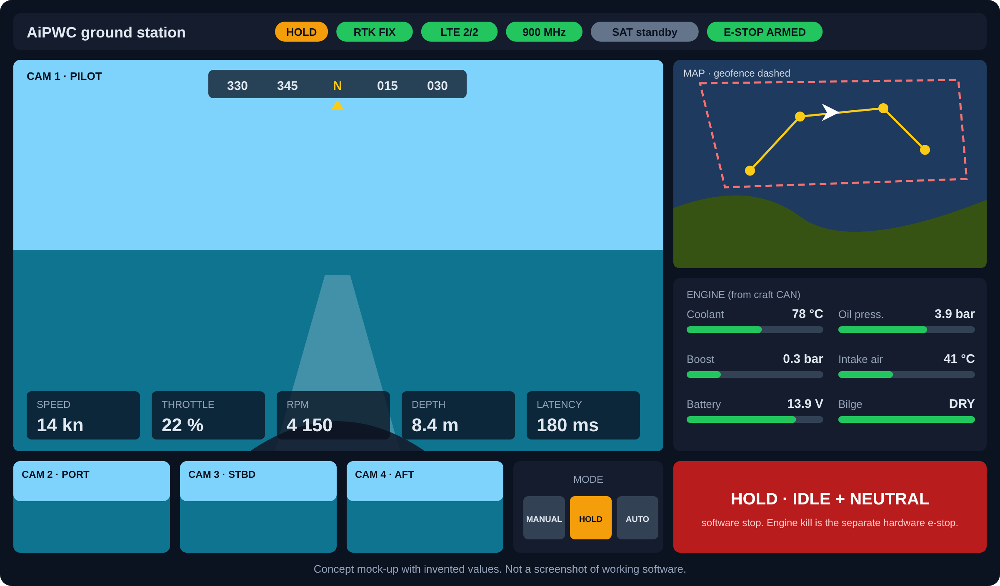

# Design Concept and Mock-ups

Concept drawings showing where the parts chosen in the [BOM](02-bom.md) and
[parts list](03-sourcing.md) go on the craft.

These are schematic mock-ups drawn from the design documents, not from
measurements or photographs of the craft. The hull outline is generic, nothing
is to scale, and every position must be checked against the real RXP-X 300
before brackets are made. The drawings are generated by
[`tools/gen_concept.py`](../tools/gen_concept.py), and the photo boards and PNG
copies by [`tools/gen_boards.js`](../tools/gen_boards.js); edit positions there
and re-run to update them.

## 1. Equipment layout

The board above places photos of the selected parts around the layout drawing. The plain drawings and the table below give every numbered position.

| # | Item | Selected part | Location and reason |
|---|---|---|---|
| 1 | Avionics box | Polycase WQ enclosure holding the Cube Orange+, Raspberry Pi 5, VIU, router and radios | Front storage bin: coolest, driest, least vibration |
| 2 | Avionics power | 12 V LiFePO4 battery, Victron Orion-Tr isolated converters | Beside the avionics box, short cable run, away from engine heat |
| 3 | GNSS antenna, bow | CubePilot Here4 | On the hood with clear sky view |
| 4 | GNSS antenna, aft | CubePilot Here4 | On a mast outrigger. Bow-to-aft spacing of about 2 m gives accurate GNSS heading |
| 5 | Steering actuator | Ultra Motion Servo Cylinder, AM series | Under the helm cover, on the steering stem arm, with a breakaway link. The stock cable stays in place |
| 6 | Throttle and iBR interface | T-harnesses to the VIU | At the handlebar lever sensors: throttle on the right grip, iBR on the left |
| 7 | Pilot camera | Axis P1465-LE | On the helm cowl, looking forward over the bow |
| 8 | Side and aft cameras | Three fixed IP67 PoE cameras | On the mast, above spray, covering port, starboard and astern |
| 9 | Antenna mast | Poynting OMNI-402-5G, RFD900x antenna, e-stop antenna, Iridium patch, all-round light | Rear deck, folding for trailering. Height is what gives radio range over water |
| 10 | Local stop buttons | IP67 mushroom buttons, two | One on the rear deck reachable from the water or a chase boat, one at the helm |
| 11 | Aft safety box | Wireless e-stop receiver and kill relays K1–K3 in a sealed box | Under the seat near the craft's fuse box. Separate from the avionics box on purpose |
| 12 | Fuel vapour sensor | Fireboy-Xintex G-series sensor | Low in the engine bay, where vapour collects, clear of bilge water |
| 13 | Bilge pump and high-water switch | Rule LoPro LP900S, Water Witch 101 | Lowest point aft |
| 14 | Nozzle angle sensor | Novotechnik RFC-4800 | At the nozzle pivot, measuring the real nozzle angle |
| 15 | Depth sounder | Blue Robotics Ping2 | Inside the hull bottom, shooting through the hull if the laminate allows; otherwise transom mounted |
| 16 | CAN tap | Isolated listen-only transceiver on a T-harness | At the diagnostic connector. Its real location comes from the shop manual |

Grey dashed boxes are stock items (engine, fuel tank, craft battery, jet pump and iBR gate) shown for orientation only; their positions are approximate.

## 2. Selected parts, with photos

Photos of the selected parts, keyed to the numbers on the layout drawings above.
Prices and importance levels are from the [parts list](03-sourcing.md), which defines the levels.

The photos are the sellers' and manufacturers' own images and remain their
copyright. In this table they are shown by link from the vendors' sites and
credited in the last column; if a seller moves a picture, that cell will show a
broken image. The two photo boards on this page contain reduced copies of the
same photos, used to identify the parts.

| Layout # | Photo | Part | Price | Importance | Where it goes | Photo from |
|---|---|---|---|---|---|---|
| 1 |  | Cube Orange+ Standard Set | $450 | Critical | Autopilot, inside the avionics box | [IR-LOCK](https://irlock.com/products/cube-orange-plus-standard-set) |
| 1 |  | Teensy 4.1 | $32 | Critical | Vehicle Interface Unit controller, inside the avionics box | [SparkFun](https://www.sparkfun.com/products/16771) |
| 1 |  | RockBLOCK 9603 | $300 | Recommended | Iridium modem, inside the avionics box | [SparkFun](https://www.sparkfun.com/rockblock-9603n-iridium-satcomm-module.html) |
| 1 |  | RFD900x bundle (antennas and cables shown) | $220–380 | Required | 900 MHz telemetry radio, inside the avionics box | [IR-LOCK](https://irlock.com/products/rfd900ux-us-modem-bundle-fcc) |
| 1 |  | Blue Sea 5025 fuse block | $40–60 | Required | Fused distribution, inside the avionics box | [Mealey Marine](https://mealeymarine.com/products/blue-sea-5025-st-blade-fuse-block-w-cover-6-circuit-w-negative-bus-5025) |
| 2 |  | Victron Orion-Tr Smart 12/12-18 isolated charger | $160–270 | Required | Charges the avionics battery from the craft battery | [Mealey Marine](https://mealeymarine.com/products/victron-orion-tr-smart-12-12-18-18a-220w-isolated-dc-dc-charger-or-power-supply-ori121222120) |
| 2 |  | Blue Sea 6006 battery switch | $30–45 | Required | Isolates the avionics system | [Mealey Marine](https://mealeymarine.com/products/blue-sea-6006200-battery-switch-mini-on-off-black-6006200) |
| 3, 4 |  | CubePilot Here4 | $225–280 each | Critical | GNSS antennas at the bow and on the mast | [IR-LOCK](https://irlock.com/products/here4-multiband-rtk-gnss) |
| 5 |  | Ultra Motion Servo Cylinder, AM series | $1,500–4,000 | Critical | Steering actuator under the helm | [Ultra Motion](https://www.ultramotion.com/servo-cylinder?series=am) |
| 7 |  | Axis P1465-LE | $600–900 | Required | Pilot camera on the helm cowl | [Axis](https://www.axis.com/products/axis-p1465-le) |
| 9 |  | Poynting OMNI-402 | $409–450 | Required | Cellular antenna on the mast | [Poynting](https://poynting.tech/antennas/omni-402/) |
| 11 |  | FORT Wireless E-Stop (handheld transmitter) | $2,500–5,000 | Critical | Shore-side stop transmitter; its receiver is in the aft safety box | [Clearpath Robotics](https://store.clearpathrobotics.com/products/wireless-e-stop) |
| 12 |  | Fireboy-Xintex G-1B-R | $200–350 | Critical | Fuel vapour detector display; its sensor sits low in the engine bay | [Mealey Marine](https://mealeymarine.com/products/xintex-gasoline-fume-detector-alarm-w-plastic-sensor-black-bezel-display-g-1b-r) |
| 13 |  | Rule LoPro LP900S | $87–118 | Required | Automatic bilge pump at the lowest point aft | [Mealey Marine](https://mealeymarine.com/products/rule-lopro-900gph-bilge-pump-automatic-lp900s) |
| optional |  | FLIR M232 | $2,795–3,095 | Optional | Pan/tilt thermal camera, if fitted, on the mast | [Mealey Marine](https://mealeymarine.com/products/flir-m232-pan-tilt-9hz-marine-thermal-camera-e70354) |

No photo is shown for the Blue Robotics Ping2, Raspberry Pi 5, Peplink router,
Teltonika switch, Polycase enclosure, Water Witch switch or Novotechnik sensor:
those sites either refused automated access or serve their pictures from a host
this session could not reach. Their product pages are linked in the
[parts list](03-sourcing.md).

## 3. Avionics box

- Three rows on one aluminium plate that doubles as the heat spreader: radios and network at the top, computing and vehicle interface in the middle, power at the bottom.
- The Cube is mounted rigidly, level, with its arrow pointing to the bow.
- Radios sit furthest from the DC-DC converters to keep switching noise out of the receivers.
- Every cable leaves through the underside. Antenna leads go to bulkhead connectors so the box can be lifted out.
- The clear lid shows status LEDs without opening the seal.

## 4. Ground station screen

This is a concept for the operator's view, built from standard QGroundControl or Mission Planner panels plus the video feeds. The values shown are invented.

- **Status strip:** mode, GNSS fix, each data link, and e-stop radio state, always visible.
- **Pilot video:** heading tape on top; speed, throttle, RPM, depth and video latency along the bottom. Latency is shown because it limits safe speed.
- **Map:** track, waypoints and the geofence.
- **Engine panel:** values decoded from the craft's CAN bus, plus bilge state.
- **Hold button:** commands idle and neutral through the autopilot. The engine kill is the separate hardware e-stop transmitter, which is a physical device and deliberately not on this screen.

## 5. What these drawings do not settle

| Open point | Needs |
|---|---|
| Whether the avionics box and battery fit the front bin | Measure the bin; the RXP-X bin is small |
| Actuator mounting under the helm | Measure clearance around the steering stem at full lock |
| Mast base and deck reinforcement | Backing plate design; loads from slamming |
| Weight and trim | Roughly 25–35 kg added, some of it high on the mast; check on the water |
| Cable routes through the bulkheads | Use existing grommets where possible; seal any new holes |
